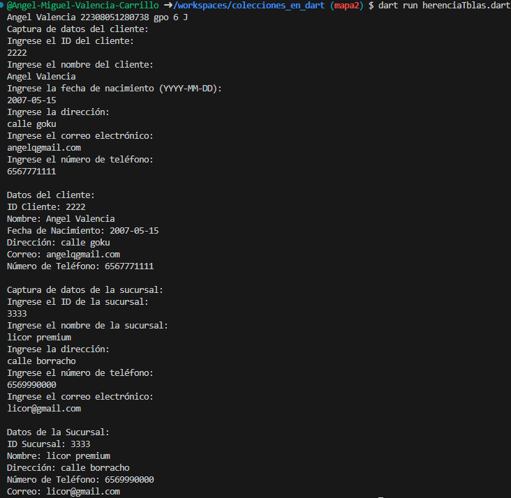

crear la clase cliente con atributos (id_cliente , nombre, fecha_nacimiento, direccion, correo, num_telefono)
 y una funcion capturadatos() "los datos se capturan desde la interfaz",
  una clase Angel con herencia cliente y una funcion mostrardatos(),

 crear la sucursales con atributos (id_sucursales , 
 nombre, direccion, num_telefono, correo) y una funcion capturadatos() 
 "los datos se capturan desde la interfaz", 
 una clase sucursal con herencia sucursales y una funcion mostrardatos(), lenguaje dart

 salida 
 